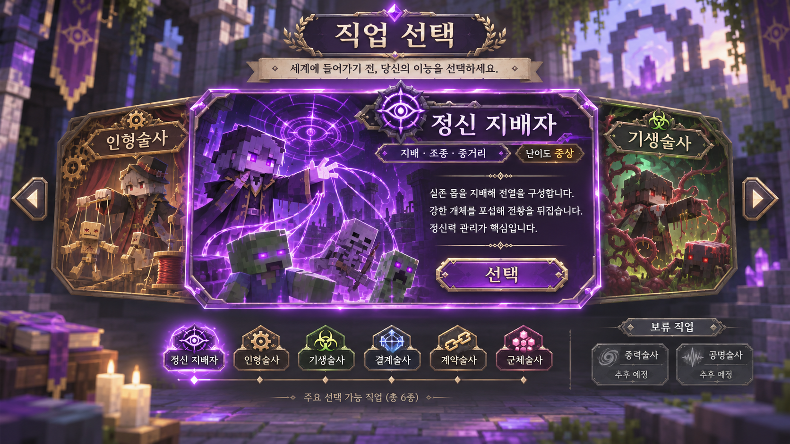
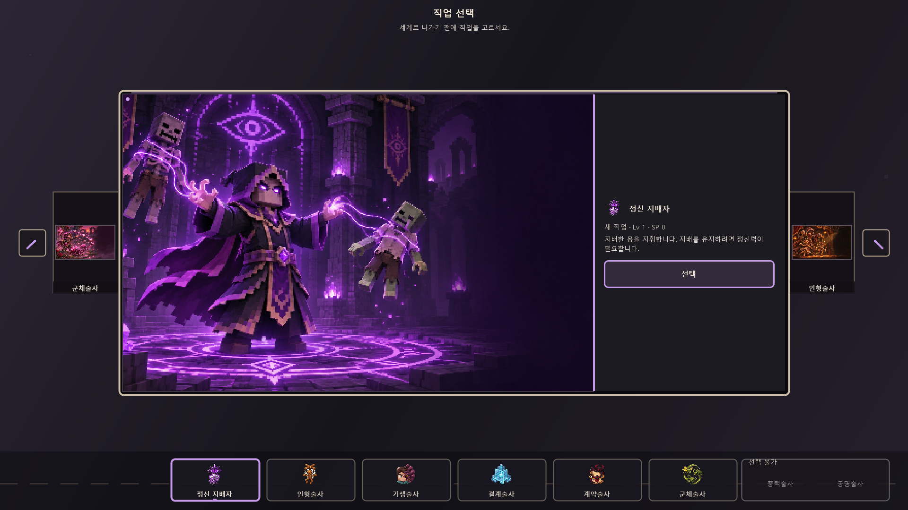
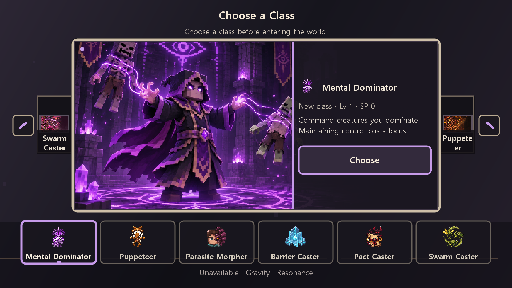
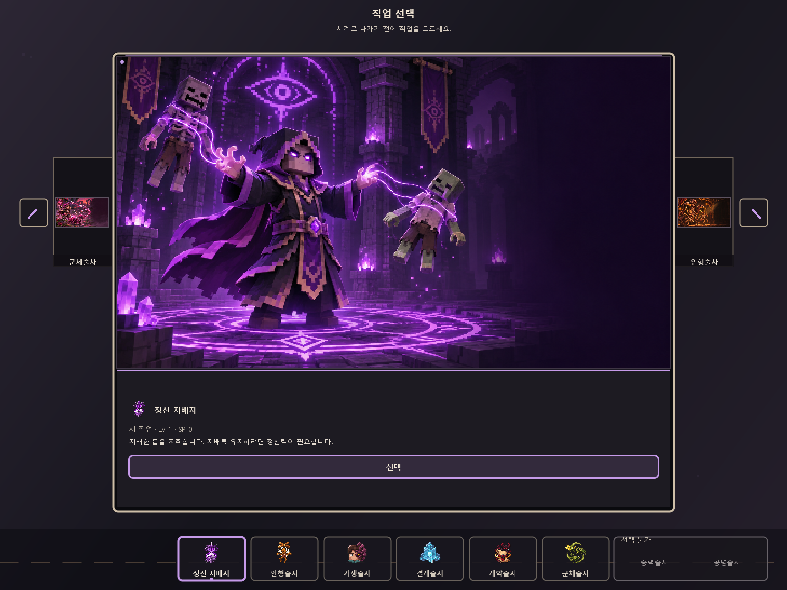
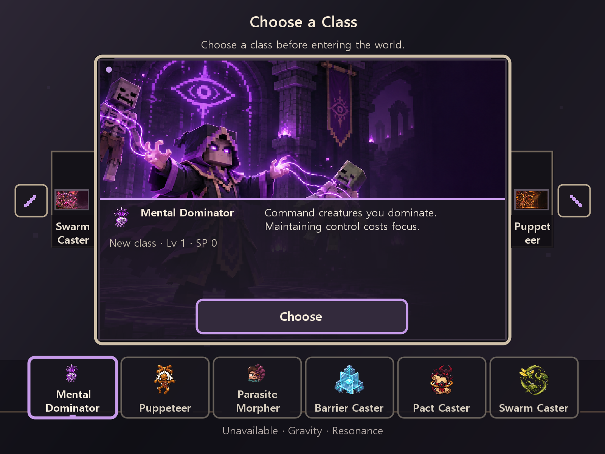

# 직업 선택 UI 정적 레이아웃 검토

**검토 범위:** UI 렌더링 순서, 화면 선명도 경로, 카드·텍스트·버튼·탭 좌표와 리소스만 확인했다. 전투·밸런스·직업 재미는 확인하거나 변경하지 않았다.

## 블러 원인과 수정

프로젝트의 정확한 런타임 의존물인 `neoforge-21.1.244-merged.jar`의 Minecraft 1.21.1 `Screen.class` 바이트코드를 확인했다.

- `Screen.render()`는 먼저 가상 메서드 `renderBackground()`를 호출한 다음 `renderables` 목록을 그린다.
- `Screen.renderBackground()`는 `GameRenderer.processBlurEffect()`를 호출하고 월드/메뉴 배경과 NeoForge 배경 렌더 이벤트를 처리한다.
- 이전 `ClassSelectionScreen.render()`도 자체 카드·문구를 그리기 전에 `renderBackground()`를 부른 뒤, 마지막에 `super.render()`를 호출했다. 따라서 프레임마다 배경 블러가 두 번 실행됐고, 마지막 `super.render()`가 두 번째 배경 패스를 실행하며 먼저 그려 둔 사용자 UI를 흐리게 덮었다.
- 수정 후 배경 패스는 한 번이다. 배경·카드·문구를 그린 뒤 등록된 `renderables`를 직접 순회한다. 버튼은 여전히 `addRenderableWidget()`로 등록되어 입력·포커스·내레이션 경로를 유지한다. 서버 패킷, 상태 저장, 직업 선택 처리는 수정하지 않았다.

UI PNG와 짝지어진 `.mcmeta` 파일은 없다. Minecraft 1.21.1 텍스처 메타데이터 파서는 `blur` 누락을 `false`로 처리하고, `SimpleTexture`는 그 값을 로드에 넘긴다. `AbstractTexture.setFilter(false, false)` 바이트코드는 축소/확대 필터 모두 `GL_NEAREST`를 지정한다. 따라서 텍스처 필터나 전역 그래픽 설정은 이 UI 흐림의 원인이 아니며 이번 수정에서 바꾸지 않았다. 픽셀 아이콘은 정수 목적 크기로 `blit`하고, 카드 이미지는 가로세로 비율을 유지한 채 클립 영역에 맞춰 잘라낸다.

하단 보류 직업 영문 이름은 고정 폭에 억지로 축소하지 않고 두 줄로 감싼다. 나머지 본문과 탭은 런타임의 Minecraft 폰트에서 폭을 측정해 `font.split()`으로 줄을 나눈다. 작은 해상도에서 작은 한 줄 텍스트의 비정수 축소도 줄였다.

## 레이아웃 조정

- 16:9·16:10 넓은 화면: 카드 아트를 큰 좌측 영역에 꽉 채우고 설명/상태/선택 버튼은 더 좁은 우측 패널에 세로 중앙 정렬한다.
- 4:3 일반 화면: 16:9 아트 위, 설명과 선택 버튼 아래로 분리해 아트 비율을 유지한다.
- 작은 논리 화면: 16:9·16:10은 오른쪽 정보 패널을 아트 위에, 4:3은 아래 정보 띠를 아트 위에 겹친다. 작은 화면에서 원본 아트의 검은 여백을 줄이고 카드 내용은 클립한다.
- 좌우 미리보기는 중앙 아트의 세로 중심에 배치하고 실제 직업 썸네일과 이름을 표시한다. 화면 밖으로 나가는 툴팁은 사용하지 않는다.
- 여섯 직업 탭을 카드 축 아래 가운데에 모으고 기존 아이콘을 유지한다. 보류 직업은 넓은 화면의 작은 우측 패널 또는 작은 화면의 한 줄 표시로 정리한다.
- 선택 버튼의 화면 좌표는 렌더링과 동일한 `ClassSelectionLayout` 계산값을 사용한다. 카드 전환 중에도 버튼 위젯 위치를 같은 오프셋으로 갱신해 표시와 클릭 판정을 맞춘다.

이번 수정에서 여섯 카드 일러스트와 여섯 직업 아이콘 파일은 변경하지 않았다.

## 화면 크기별 정적 좌표 검사

화면 비율별 물리 해상도를 GUI Scale로 나눈 논리 화면 크기에 `ClassSelectionLayout.calculate()`를 적용했다. 아트·상세 영역, 액션 버튼, 양쪽 미리보기, 화살표, 탭, 보류 영역의 화면 경계와 겹침을 검사했다. 버튼은 설명 1–4줄과 상태 0–2줄 조건에서 상세 영역에 머무는지 확인했다. 작은 4:3 하단 정보 띠는 설명/상태 영역과 메타 정보 영역을 각각 검사했다. 전환 거리에서 카드와 액션 버튼이 함께 움직이는 좌표도 확인했다.

| 화면 비율 | GUI Scale | 논리 화면 | 레이아웃 | 카드 | 아트 | 상세 | 선택 버튼 | 좌우 미리보기 폭 | 탭 폭 | 결과 |
|---|---:|---:|---|---:|---:|---:|---:|---:|---:|---|
| 16:9 | 2 | 960×540 | 좌우 분할 | 710×324 | 497×314 | 203×314 | 179×28 | 69 / 69 px | 93 px | PASS |
| 16:9 | 3 | 640×360 | 우측 정보 겹침 | 461×230 | 453×222 | 181×222 | 169×28 | 43 / 44 px | 94 px | PASS |
| 16:9 | 4 | 480×270 | 우측 정보 겹침 | 346×163 | 340×157 | 136×157 | 124×26 | 32 / 32 px | 70 px | PASS |
| 16:10 | 2 | 960×600 | 좌우 분할 | 710×336 | 497×326 | 203×326 | 179×28 | 69 / 69 px | 93 px | PASS |
| 16:10 | 3 | 640×400 | 우측 정보 겹침 | 461×256 | 451×246 | 180×246 | 168×28 | 40 / 41 px | 94 px | PASS |
| 16:10 | 4 | 480×300 | 우측 정보 겹침 | 346×192 | 338×184 | 135×184 | 123×28 | 30 / 30 px | 70 px | PASS |
| 4:3 | 2 | 800×600 | 위아래 분리 | 572×468 | 562×316 | 562×140 | 538×23 | 60 / 60 px | 68 px | PASS |
| 4:3 | 3 | 533×400 | 하단 정보 겹침 | 384×256 | 374×246 | 374×112 | 194×22 | 29 / 30 px | 78 px | PASS |
| 4:3 | 4 | 400×300 | 하단 정보 겹침 | 276×192 | 268×184 | 268×93 | 139×22 | 28 / 28 px | 58 px | PASS |

## 비교 자료

왼쪽은 사용자가 제공한 참고 화면이다. 나머지 이미지는 수정된 레이아웃 코드와 현재 리소스로 생성한 정적 미리보기이며 Minecraft 캡처가 아니다.











## 검증 경계와 남은 확인

- **STATIC REVIEW — PASS:** 9개 화면 크기의 경계·정렬·영역 겹침, 렌더 순서, 버튼 위젯의 렌더/클릭 좌표 일치, 애니메이션 오프셋을 소스와 좌표 계산으로 확인했다.
- **STATIC TEXT REVIEW — PASS:** 한국어·영어 리소스 문구를 정적 미리보기에 넣어 작은/큰 화면을 확인했다. 실제 게임은 Minecraft 폰트에서 런타임 폭 측정과 줄바꿈을 한다.
- **STATIC RESOURCE REVIEW — PASS:** 기존 직업 아이콘은 각각 96×96, 카드 이미지는 각각 512×288이다. 아이콘의 PNG 투명 배경을 유지한다. 이번 수정에서 카드/아이콘 파일을 바꾸지 않았다.
- **CLIENT RUNNING — YES:** 이번 프로젝트의 `runClient` 프로세스를 빌드 후 시작했고, 로그에 `anomalousclasses` 리소스 재로드와 클라이언트 렌더 스레드 초기화가 기록됐다. 작업 완료 후에도 창을 켜 둔다.
- **CLASS SCREEN OPEN — NO / CLIENT TESTED — NOT RUN:** CUA를 사용하거나 게임 화면을 조작하지 않았다. 직업 선택 화면·클릭·포커스·전환은 실제 클라이언트에서 확인하지 않았으며 사용자가 직접 검수한다.
- **GAMEPLAY REVIEW — NOT RUN:** 전투 체감, 직업 성능, 밸런스, 성장, AI 및 직업 재미는 이번 검토 범위가 아니다.

정적 검사 재현 명령:

```powershell
javac -d build/ui-review/layout-classes src/main/java/kr/moonseungjun/anomalousclasses/client/ClassSelectionLayout.java tools/VerifyClassSelectionLayout.java tools/RenderClassSelectionStaticPreview.java
java -cp build/ui-review/layout-classes VerifyClassSelectionLayout
```
